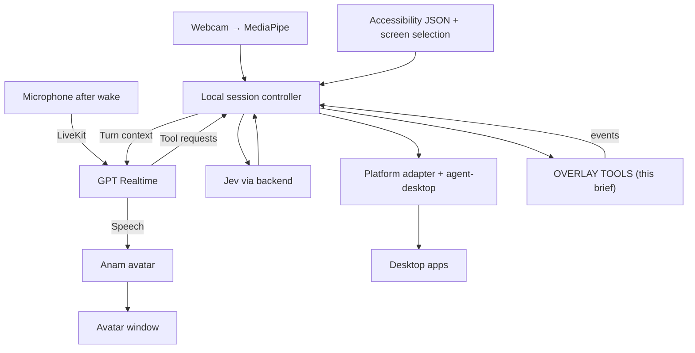

# Pointy: Overlay & Explainer Tools (Build Brief for Claude Code)

## 0. Read this first

**Your job:** build the **drawing layer** of Pointy. These are the tools the AI calls to draw on the user's screen: point at things, highlight things, walk through steps, and show diagram explainer cards (some illustrated with fal.ai), all overlaid on top of the real desktop.

**In scope (build this):**
- Shared schemas for the overlay tools, their results and their events
- Transparent, click-through overlay windows (one per display)
- Overlay manager, anchor tracker, layout engine, expiry logic
- Visual primitives: pointer, ring, spotlight, underline, step badges, explainer cards
- Explainer templates (`sequence`, `compare`, `anatomy`) and fal.ai `concept` cards
- A small backend broker for fal.ai image generation
- A dev CLI / debug panel so everything can be tested without the AI or camera

**Out of scope (do NOT build; other teammates own these):**
- Hand tracking, gestures (MediaPipe)
- Voice, GPT Realtime, LiveKit agent, Anam avatar
- Reading the accessibility tree, taking actions (click/type), Jev, agent-desktop

Where you depend on those parts, **define a small interface and build a mock** (see section 6). Section 9 (overall architecture) is **background context only**, so you know where the overlay fits. Do not implement it.

**Rules:**
- The shared schema file (section 4) is the contract with the team. Ask before changing a field another teammate depends on.
- Prefer small, testable modules. Write unit tests for logic (layout, coordinates, expiry, anchor tracking).
- Platform: **macOS first**. Keep anything macOS-specific behind a small adapter so Windows can be added later.
- Stack: **Electron + TypeScript + React**, `zod` for schemas.
- If an API detail in this brief is marked **(verify)**, check the current docs or test it before relying on it.

---

## 1. Product context (short)

Pointy helps elderly people use a computer without a mouse. They raise a hand to wake it, optionally point at or circle something on screen, and speak ("What is this?", "Where are my photos?", "Is this email safe?"). An AI avatar answers, and **your overlay shows them where to look**.

Design for older users:
- Big, high-contrast, calm and slow
- One thing at a time
- Never cover the thing you're explaining

---

## 2. Features

### 2.1 Core tools (MVP)

**`point_at(target, opts)`**
- A large hand/arrow glides in from the nearest screen edge, taps the target twice, then rests beside it.
- Options:
  - `label`: short caption next to the pointer
  - `motion`: `"tap" | "double_tap" | "drag_to"`
  - `dragTo`: second target, used with `drag_to` to *teach* a motion (e.g. drag a file into a folder; animated, loops twice)

**`highlight(target, opts)`**
- `style`:
  - `ring`: soft pulsing outline ("here it is")
  - `spotlight`: dims everything except the target to about 60% black ("look only here"); strongest option for elderly users
  - `underline`: thick underline for a line of text (email, document)
- `tone`: `info` (blue), `warning` (amber + ⚠ icon, e.g. scam links), `success` (green + ✓)
- Optional `label`

**`show_steps(steps[])`**
- Numbered badges (① ② ③) pinned to real elements, with a dotted path between them.
- Only the current step is bright; future steps are faint, past steps show a ✓.
- Advances when:
  - the controller reports an action on that step's target
  - the user selects that target by gesture
  - the AI calls `advance_step`
- Max 5 steps.

**`advance_step(stepsId)`**: moves a step set forward one step.

**`show_explainer(spec)`**
- A diagram card placed **beside** an anchor, with a connector line to it.
- Four kinds:

| Kind | Use | Rendered by |
| --- | --- | --- |
| `concept` | "What is the cloud?" | fal.ai image(s) + locally rendered captions |
| `sequence` | "How to attach a photo" | Local SVG template: icons + arrows, 2 to 5 steps |
| `compare` | "Real vs scam email" | Two panels side by side, each with title + bullet points (+ optional fal.ai image) |
| `anatomy` | "What are all these buttons?" | **Zoomed crop of the user's own screen** with numbered labelled callouts |

- `anatomy` is the standout feature: it explains the user's *actual* window. It needs no fal.ai.

**`clear(overlayId | "all")`**: always fades out (300 ms); never disappears abruptly.

### 2.2 Stretch tools (only after MVP is solid)

- **`magnify(target, zoom)`**: a circular magnifier lens (2x to 4x) over small text or icons
- **`preview_action(target, actionLabel)`**:
  - A dashed "ghost" highlight plus "I'm about to *Delete* this. OK?"
  - The controller calls this before risky actions; it is removed when the action runs or is cancelled
- **Speech-synced cues**:
  - Any tool may carry `cue: string`. If present, the overlay is prepared but hidden.
  - It appears when the voice side fires `cue(cueId)`, at the moment the avatar says "this button".
- **"Show me again"**: `replay_last()` re-shows the most recent annotation set from history.

### 2.3 Golden rule for text in images

**Image models must never render words.** All titles, captions, labels and numbers are rendered locally in HTML/SVG. fal.ai prompts always end with the style suffix (section 7.3) that includes "no text".

---

## 3. Visual design rules (theme tokens)

Put these in one `theme.ts` file; everything reads from it.

| Token | Value |
| --- | --- |
| `fontMin` | 24 px (labels), 28 px (card titles) |
| `font` | System UI font, weight 600 for labels |
| `stroke` | 6 px for rings, arrows, underlines |
| `outline` | 3 px white outer outline on every shape and label (visible on any background) |
| `colors.info` | `#2563EB` |
| `colors.warning` | `#F59E0B` |
| `colors.success` | `#16A34A` |
| `colors.labelBg` | `#111827` at 92% opacity, white text |
| `spotlightDim` | `rgba(0,0,0,0.6)` |
| `anim.enter` / `anim.exit` | 450 ms / 300 ms, ease-out |
| `anim.pulseCount` | 3 pulses, then hold still |
| `pointerSize` | 96 px |
| `cardMaxWidth` | 520 px |
| `edgeMargin` | 24 px |
| `reduceMotion` | boolean; when true, no glides or pulses, just fade in |

Never flash. Never rely on colour alone: pair colour with an icon or number.

---

## 4. Shared contract (`packages/shared/src/overlay/schemas.ts`)

Adapt paths to the existing repo; if none exists, use the layout in section 8.

All coordinates are **global DIP (points)**, top-left origin of the primary display, which matches Electron's `screen` module. Convert to physical pixels only when cropping screenshots (`× display.scaleFactor`).

```ts
import { z } from "zod";

// ---------- Geometry ----------
export const Point = z.object({ x: z.number(), y: z.number() });
export const Rect = z.object({
  x: z.number(), y: z.number(),
  width: z.number().positive(), height: z.number().positive(),
});

// ---------- Targets ----------
// Prefer `element`: it follows the element when windows move or scroll.
export const Target = z.discriminatedUnion("kind", [
  z.object({ kind: z.literal("element"), elementId: z.string(), snapshotRevision: z.number().int().optional() }),
  z.object({ kind: z.literal("rect"), displayId: z.string(), rect: Rect }),
  z.object({ kind: z.literal("point"), displayId: z.string(), point: Point }),
  z.object({ kind: z.literal("polygon"), displayId: z.string(), points: z.array(Point).min(3) }),
]);

// ---------- Lifetime ----------
export const Expiry = z.union([
  z.enum(["next_turn", "on_target_selected", "context_change", "manual"]),
  z.object({ ms: z.number().int().min(500).max(120_000) }),
]);
// Default: "next_turn"

const Common = {
  label: z.string().max(60).optional(),
  expires: Expiry.optional(),
  cue: z.string().optional(),          // stretch: speech-synced reveal
  turnId: z.string().optional(),       // filled by the controller, not the model
};

export const Tone = z.enum(["info", "warning", "success"]);

// ---------- Tool inputs ----------
export const PointAtInput = z.object({
  target: Target,
  motion: z.enum(["tap", "double_tap", "drag_to"]).default("tap"),
  dragTo: Target.optional(),
  ...Common,
});

export const HighlightInput = z.object({
  target: Target,
  style: z.enum(["ring", "spotlight", "underline"]).default("ring"),
  tone: Tone.default("info"),
  ...Common,
});

export const ShowStepsInput = z.object({
  steps: z.array(z.object({ target: Target, label: z.string().max(40) })).min(1).max(5),
  startAt: z.number().int().min(0).default(0),
  expires: Expiry.optional(),
  turnId: z.string().optional(),
});

export const AdvanceStepInput = z.object({ stepsId: z.string() });

// Fixed icon set for templates (render locally as SVG).
export const IconName = z.enum([
  "click", "type", "folder", "file", "photo", "email", "attach", "send",
  "search", "settings", "wifi", "cloud", "lock", "warning", "check",
  "trash", "download", "printer", "phone", "video", "person",
]);

export const ShowExplainerInput = z.object({
  anchor: Target.optional(), // card is placed beside this; if absent, centred-right of the screen
  title: z.string().max(50),
  expires: Expiry.optional(),
  cue: z.string().optional(),
  turnId: z.string().optional(),
  spec: z.discriminatedUnion("kind", [
    z.object({
      kind: z.literal("concept"),
      panels: z.array(z.object({
        caption: z.string().max(90),
        imagePrompt: z.string().max(300), // describe a picture; NO text in it
      })).min(1).max(3),
    }),
    z.object({
      kind: z.literal("sequence"),
      steps: z.array(z.object({ icon: IconName, caption: z.string().max(60) })).min(2).max(5),
    }),
    z.object({
      kind: z.literal("compare"),
      left: z.object({ title: z.string().max(30), points: z.array(z.string().max(60)).max(4), imagePrompt: z.string().optional() }),
      right: z.object({ title: z.string().max(30), points: z.array(z.string().max(60)).max(4), imagePrompt: z.string().optional() }),
    }),
    z.object({
      kind: z.literal("anatomy"),
      region: Target, // the part of the screen to crop (often the user's circled polygon)
      callouts: z.array(z.object({ target: Target, label: z.string().max(40) })).min(1).max(6),
    }),
  ]),
});

export const ClearInput = z.object({ overlayId: z.union([z.string(), z.literal("all")]) });

// Stretch
export const MagnifyInput = z.object({ target: Target, zoom: z.number().min(2).max(4).default(2.5), expires: Expiry.optional() });
export const PreviewActionInput = z.object({ target: Target, actionLabel: z.string().max(30) });

// ---------- Tool result (returned to the model) ----------
export const ToolResult = z.object({
  ok: z.boolean(),
  overlayId: z.string().optional(),
  visible: z.boolean(),                 // false if target is off-screen/not found
  resolvedBounds: Rect.optional(),
  reason: z.enum(["target_not_found", "target_offscreen", "invalid_input", "display_not_found", "replaced"]).optional(),
});

// ---------- Events (sent back to the controller → AI) ----------
export const OverlayEvent = z.discriminatedUnion("type", [
  z.object({ type: z.literal("overlay.shown"), overlayId: z.string() }),
  z.object({ type: z.literal("overlay.target_lost"), overlayId: z.string() }),
  z.object({ type: z.literal("overlay.target_selected"), overlayId: z.string() }),
  z.object({ type: z.literal("overlay.dismissed"), overlayId: z.string(), by: z.enum(["user", "model", "controller"]) }),
  z.object({ type: z.literal("overlay.expired"), overlayId: z.string() }),
  z.object({ type: z.literal("steps.advanced"), stepsId: z.string(), index: z.number().int() }),
  z.object({ type: z.literal("steps.completed"), stepsId: z.string() }),
  z.object({ type: z.literal("explainer.image_ready"), overlayId: z.string(), panel: z.number().int() }),
  z.object({ type: z.literal("explainer.image_failed"), overlayId: z.string(), panel: z.number().int() }),
]);
```

Export JSON Schemas from these for the model's function-calling definitions (zod v4 `z.toJSONSchema`, or `zod-to-json-schema`) **(verify which zod version the repo uses)**.

### 4.1 Tool descriptions (what the model reads)

These matter as much as the code. Put them in `tools.ts` next to the schemas.

- **point_at**: "Animate a large pointer onto one thing the user should click or look at. Use when telling the user *what to press next*. Prefer `kind: element` targets."
- **highlight**: "Mark something on screen. `spotlight` dims everything else; use it when the user asks where something is. `underline` for text. Use `tone: warning` for anything risky (suspicious links, delete buttons). Only one highlight at a time; a new one replaces the old."
- **show_steps**: "Show a short numbered path (max 5) across real on-screen controls, for multi-step tasks. Only the current step is emphasised."
- **advance_step**: "Move a step guide forward when the user has done the current step."
- **show_explainer**: "Show a picture card beside something on screen, only when a picture explains better than words. `anatomy` labels parts of the user's own screen; `sequence` shows a short how-to; `compare` shows two things side by side; `concept` illustrates an idea. Never put words inside `imagePrompt`; captions carry all text."
- **clear**: "Remove annotations. Call with `all` when the user says 'got it', 'okay' or changes topic."

---

## 5. Runtime architecture of the overlay

```
Controller (teammate)  ──tool call──▶  OverlayService (main process)
                                         ├─ validates input (zod)
                                         ├─ TargetResolver   → BoundsProvider (mock/teammate)
                                         ├─ LayoutEngine     → placement for labels/cards
                                         ├─ OverlayManager   → state, z-order, max 3 visible, history
                                         ├─ ExpiryManager    → next_turn / timers / context_change
                                         ├─ AnchorTracker    → polls bounds, moves/fades annotations
                                         ├─ ExplainerService → templates, anatomy crop, fal.ai broker
                                         └─ IPC "overlay:render" ─▶ OverlayWindow (one per display, React)
OverlayService ──OverlayEvent──▶ Controller
```

### 5.1 Overlay windows

One `BrowserWindow` per display, sized to `display.bounds`:
- `transparent: true`, `frame: false`, `hasShadow: false`, `focusable: false`, `skipTaskbar: true`, `resizable: false`, `movable: false`
- macOS: `type: "panel"` **(verify)** so it never steals focus
- `setAlwaysOnTop(true, "screen-saver")`
- `setVisibleOnAllWorkspaces(true, { visibleOnFullScreen: true })`
- `setIgnoreMouseEvents(true)`: fully click-through. The user never interacts with the overlay; dismissal is by voice, gesture or the controller.
- `setContentProtection(true)` so screenshots sent to the AI don't include our drawings. **(verify on the target macOS version:** newer ScreenCaptureKit-based capture may still capture protected windows. If it does, the capture teammate must exclude our window IDs via the capture filter, or the overlay must hide for one frame during capture. Expose `getOverlayWindowIds()` and `withOverlayHidden(fn)` for that.)
- Listen to `screen` `display-added` / `display-removed` / `display-metrics-changed` and rebuild windows.
- Global → local conversion: `local = global - display.bounds.{x,y}`.
- Also expose the avatar window's bounds to the LayoutEngine as an "avoid" rect.

Renderer: React + SVG for shapes; HTML for text and cards. CSS transitions for animation (respect `reduceMotion`).

### 5.2 OverlayManager

- Each annotation: `{ id, toolName, input, resolvedBounds, displayId, state: "pending"|"visible"|"exiting", createdAt, turnId }`.
- **Max 3 visible.** A step set counts as one. A new `highlight` replaces the previous `highlight` (result `reason: "replaced"` on the old one's event stream). The oldest non-step annotation is evicted first.
- Keep a short history (last 5 sets) for `replay_last`.
- Pending (cue-gated) annotations are resolved and laid out but hidden until `cue(cueId)` fires; drop them at turn end.

### 5.3 TargetResolver

- `element` → `BoundsProvider.getBounds(elementId)`; `rect` / `point` / `polygon` → as given (polygon uses its bounding rect for layout, and the true path for drawing).
- If not found: return `ok: true, visible: false, reason: "target_not_found"` (so the AI can say "I can't see it right now").
- If off-screen: `visible: false, reason: "target_offscreen"`.

### 5.4 AnchorTracker

- Every ~300 ms, and immediately on `BoundsProvider.onChange`, re-resolve `element` targets.
- Moved → animate to the new bounds (150 ms).
- Not found twice in a row → fade out, emit `overlay.target_lost`.
- Coordinate-only targets (`rect` / `point` / `polygon`) expire on `context_change` (focused window changed, scroll, window moved), signalled by the controller.

### 5.5 ExpiryManager

- `next_turn`: cleared when the controller calls `onTurnStart(newTurnId)`
- `on_target_selected`: cleared when the controller reports an action on, or a gesture selection of, that element (`onTargetSelected(elementId)`)
- `context_change`: cleared on `onContextChange()`
- `{ ms }`: timer
- `manual`: only `clear`

### 5.6 LayoutEngine (pure function, unit-tested)

Input:
- target bounds
- size of the thing to place (label or card)
- display work area
- avoid rects (avatar window, other visible annotations)

Algorithm:
1. Try placements in order: right, left, below, above, each with a gap of `edgeMargin`.
2. Pick the first one that fits inside the work area without overlapping the target or the avoid rects.
3. If none fits, shrink the card to 80% and retry.
4. Then fall back to the screen corner farthest from the target, with a connector line.

The connector line runs from the nearest card edge midpoint to the nearest point on the target bounds.

---

## 6. Interfaces to teammates (mock these first)

```ts
// From the accessibility/controller teammate
interface BoundsProvider {
  getBounds(elementId: string): Promise<{ rect: Rect; displayId: string } | null>;
  onChange(cb: () => void): () => void;            // snapshot revision changed
}

// From the screen-capture teammate (for `anatomy`)
interface ScreenCaptureProvider {
  captureRegion(displayId: string, rectDip: Rect): Promise<Buffer>; // PNG, physical pixels
}

// Calls the controller makes into you
interface OverlayControl {
  handleTool(name: string, input: unknown): Promise<ToolResult>;
  onTurnStart(turnId: string): void;
  onContextChange(): void;
  onTargetSelected(elementId: string): void;
  cue(cueId: string): void;                         // stretch
  onEvent(cb: (e: OverlayEvent) => void): () => void;
  getOverlayWindowIds(): number[];
  withOverlayHidden<T>(fn: () => Promise<T>): Promise<T>;
}
```

**Mocks to ship:**
- `MockBoundsProvider`: reads element IDs and rects from a JSON file and can simulate moves and removals
- `MockScreenCaptureProvider`: uses Electron `desktopCapturer` for real crops, or a static image
- A **fixture window**: a normal Electron window with fake buttons, a fake email and a fake file list, whose element IDs and bounds feed `MockBoundsProvider`. This is the main test surface before real accessibility data exists.

---

## 7. Explainer service

### 7.1 Card shell
- Rounded card: max width 520 px, dark background, 28 px title, and the panel area
- Connector line to the anchor
- Entry: fade + slight scale from 0.96
- Card appears **within 300 ms** of the tool call: templates render instantly; `concept` panels show a calm shimmer placeholder until images arrive.

### 7.2 Templates (local, no network)
- **sequence**: a horizontal row of large icons (from the `IconName` set, as inline SVG) with arrows between them and a caption under each
- **compare**: two columns with headers, ✓ / ⚠ bullet points, and an optional image on top of each
- **anatomy**:
  1. Crop `region` with 15% padding using `ScreenCaptureProvider` (multiply DIP by `scaleFactor`).
  2. Scale the crop up to fit the card.
  3. Map each callout's global coordinates into crop coordinates.
  4. Draw numbered dots on the image plus a numbered legend underneath.

### 7.3 fal.ai broker (backend; the API key never ships in the app)
- Endpoint: `POST /explainer/image { prompt, styleId? } → { url } | { error }`.
- Use the official fal client (`@fal-ai/client` in Node, or `fal-client` in Python if the backend is Python), with `FAL_KEY` from env. **(verify current client API on fal.ai docs)**
- `FAL_MODEL_ID` comes from config. Pick a **fast** text-to-image model and record its typical latency; speed matters more than beauty. Do not hardcode a model name without checking fal.ai's current model list.
- The server appends the style suffix to every prompt:
  > `flat vector illustration, thick dark outlines, high contrast, large simple friendly shapes, warm colours, plain light background, centred subject, no text, no letters, no words, no numbers`
- Cache: key = `sha256(modelId + prompt + styleId)`; store the URL/file; return immediately on a hit.
- Timeout: 8 s. On a timeout or error, the client swaps that panel to a template fallback (the nearest `IconName`, large) and emits `explainer.image_failed`.
- `scripts/pregen-demo-images.ts`: generates the images for the demo prompts ahead of time and saves them to `assets/explainers/`. The client checks local assets first. **The live demo must not depend on fal.ai responding.**

---

## 8. Suggested file layout

```
packages/shared/src/overlay/
  schemas.ts        # section 4
  tools.ts          # tool definitions + model-facing descriptions + JSON Schema export
  theme.ts          # section 3
apps/desktop/src/main/overlay/
  OverlayService.ts
  OverlayWindowManager.ts
  OverlayManager.ts
  TargetResolver.ts
  AnchorTracker.ts
  ExpiryManager.ts
  LayoutEngine.ts          # pure
  coords.ts                # pure: global<->local, DIP<->px
  explainer/
    ExplainerService.ts
    anatomyCrop.ts
    falClient.ts           # calls our backend broker, not fal directly
  mocks/
    MockBoundsProvider.ts
    MockScreenCaptureProvider.ts
apps/desktop/src/renderer/overlay/
  OverlayRoot.tsx
  primitives/ Pointer.tsx Ring.tsx Spotlight.tsx Underline.tsx StepBadges.tsx Connector.tsx Label.tsx Magnifier.tsx
  explainer/ Card.tsx ConceptPanel.tsx SequenceTemplate.tsx CompareTemplate.tsx AnatomyTemplate.tsx icons/
apps/desktop/src/dev/
  fixtureWindow/           # fake app to point at
  devServer.ts             # localhost-only, dev builds only
tools/pointy-draw/         # CLI → devServer
backend/explainer-broker/
scripts/pregen-demo-images.ts
```

### 8.1 Dev CLI (build early)

```
pointy-draw highlight --rect 100,200,300,80 --style spotlight --label "Your photos"
pointy-draw highlight --element fixture.sendButton --tone warning
pointy-draw point --element fixture.attach --motion double_tap
pointy-draw steps fixture.newEmail:"New email" fixture.to:"Who to" fixture.send:"Send"
pointy-draw explainer --file examples/compare-scam.json
pointy-draw clear all
pointy-draw sim move fixture.sendButton 40,0     # simulate the element moving
```

The CLI posts JSON to a localhost-only dev server in the main process, which calls `OverlayControl.handleTool`. The dev server is disabled in production builds.

---

## 9. Overall Pointy architecture (CONTEXT ONLY, do not build)

**Stack:** Electron + TypeScript, MediaPipe, GPT Realtime, LiveKit (Python agent), Anam avatar, TypeSafe Jev, Vercel agent-desktop. macOS first, Windows-ready via platform adapters.

**Principle:** gestures establish context, speech establishes intent, and desktop actions begin only when the person asks.

| Component | Runs where | Responsibility |
| --- | --- | --- |
| Electron + React interface | User's computer | Avatar window, captions, status, settings, onboarding, stop control |
| MediaPipe worker | User's computer | Hand landmarks, open palm, finger tracking |
| Gesture interpreter | User's computer | Wake, point and circle-selection events |
| Session controller | User's computer | Activation, turn context, permissions, cancellation, recovery |
| Screen/context service | User's computer | Accessibility JSON + screenshots + gesture coordinates |
| Platform adapter | User's computer | agent-desktop, capture, permissions, windows, coordinates |
| **Annotation renderer (THIS BRIEF)** | User's computer | Arrows, circles, highlights, labels, steps, explainer cards |
| Python LiveKit agent | Backend | Realtime conversation; speech to Anam |
| Session API + Jev broker | Backend | Scoped credentials; authenticated Jev requests |
| GPT Realtime | OpenAI | Understands speech and images; requests tools (including ours) |
| Jev | TypeSafe | Chooses the next permitted desktop action |
| Anam | Anam | Synchronized avatar audio/video |



**Session states:**
- Idle
- Connecting
- Listening/selecting
- Resolving context
- Explaining/guiding (← overlays mostly live here)
- Acting
- Paused
- Closing

**The three input flows:**
1. Raise hand → speak
2. Raise hand → point → speak
3. Raise hand → circle an area → speak

All three produce a `TurnContext`, which may include a point or polygon. Your `anatomy` and `highlight` tools can use those directly as targets.

**Overlay-relevant rules from the main architecture:**
- Annotations attach to accessibility elements whenever possible and follow them; coordinate-only annotations expire on context change.
- Screen captures must exclude our annotations.
- "Show me" = highlight + explain. "Do it" = the controller acts (it may call `preview_action` first).
- On stop/cancel, the controller calls `clear("all")`.

---

## 10. Build plan

Assumes roughly 24 hours; scale the blocks to the real deadline.

| Phase | Build | Done when |
| --- | --- | --- |
| 0. Contracts (≈1 h) | `schemas.ts`, `tools.ts`, `theme.ts`, interfaces in section 6 | Team signs off the schema file |
| 1. Canvas (≈2 h) | Overlay windows, click-through, content protection check, dev server + CLI | A ring is drawn at fixed coordinates and does not appear in a screenshot |
| 2. Primitives (≈4 h) | `highlight` (ring/spotlight/underline), `point_at` (tap/double tap), labels, `clear`, ExpiryManager | All work on `rect` targets via the CLI |
| 3. Anchoring (≈3 h) | Fixture window, MockBoundsProvider, `element` targets, AnchorTracker, LayoutEngine | A highlight follows a fixture button when the window is dragged |
| 4. Steps (≈2 h) | `show_steps`, `advance_step`, events | A 3-step walkthrough on the fixture works via the CLI |
| 5. Explainers (≈4 h) | Card shell + connector, `sequence`, `compare`, `anatomy` | Each card appears beside its anchor within 300 ms |
| 6. fal.ai (≈3 h) | Broker, cache, timeout fallback, `concept`, pregen script | An illustrated card loads; a forced timeout falls back cleanly |
| 7. Integrate (≈2 h) | Swap mocks for the real BoundsProvider/capture; tool registration with the voice teammate; tune tool descriptions | The AI picks sensible tools from real speech |
| 8. Polish (≈3 h) | Sizes/contrast on a real screen, `reduceMotion`, `drag_to`, stretch items if time | Demo runs 3 times in a row with no fixes |

**Feature freeze before phase 8.** After that, only fixes.

## 11. Tests

- **Unit:**
  - `LayoutEngine` (every placement branch, avoid rects, shrink fallback)
  - `coords.ts` (multi-display, scale factor 1 and 2, negative display origins)
  - `ExpiryManager`
  - `AnchorTracker` with a fake clock and a fake BoundsProvider
  - Schema validation, including rejection of oversize labels and bad targets
- **Manual checklist:**
  - Retina + external monitor alignment
  - Overlay excluded from screenshots
  - Never steals focus
  - Readable on light and dark wallpapers
  - Full-screen apps
  - Annotations removed on `clear("all")`

## 12. Demo scenario to optimise for

1. The user circles a suspicious email and asks "Is this safe?".
2. `highlight` spotlight on the email, plus a `warning` underline on the link.
3. A `compare` card: "Real email vs Scam email", with pre-generated images.
4. "Want me to delete it?" → `preview_action` ghost on Delete → the controller acts → `clear("all")`.

Second scenario: "What are all these buttons?" → an `anatomy` card of the Mail toolbar with numbered labels.
