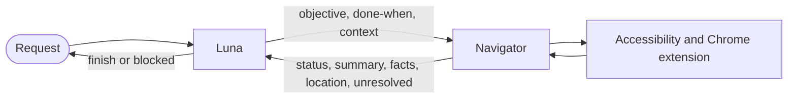

# Architecture

## The loop



Luna plans, the navigator executes, and that repeats. Each call to Luna returns exactly one decision:

- **continue**: assign the next session, as `{ objective, doneWhen, context, irreversible }`;
- **finish**: the request is done;
- **blocked**: it cannot be done, for a reason outside the assistant's reach (a sign-in or code that needs
  the user, something unavailable, a control that cannot be operated, information only the user has).

Luna alone ends a task. She never asks the user anything, and code never refuses her decision. Code states
two facts she cannot override: a finish while an action may not have arrived is reported as "completed,
unverified", and an action that cannot be undone follows the caller's `confirmIrreversible` setting.

There is no limit on steps, time or sessions.

## A session

The navigator works on one objective. On each turn it sees the screen as a list of elements and takes one
step: act on an element, read another part of the screen, search the controls, wait, or yield. The controller
checks the step against the live screen, sends it once, and reads the result.

A session ends when the navigator yields, or when it proposes the same step that changes nothing three times
against an unchanged screen. Either way Luna receives one object:

```ts
{ status,      // done | progress | needs_decision | blocked | unverified | error
  summary,     // what is true now
  facts,       // text of the elements the navigator cited
  location,    // app, window, page address
  unresolved,  // actions sent whose result nobody has seen
  steps }
```

The same object is traced, kept in memory and shown to Luna. Luna reviews the screen the navigator ended on,
with the same elements, so there is one screen read per session boundary.

## Memory

Memory belongs to one task. It is the ordered list of `{ assignment, result }` pairs, sent to Luna as a
stable prefix with the current screen last. Nothing is dropped while the task runs. Refused steps and retries
are not stored.

One request is linked to the next by the caller: a task accepts a short `context`, and its final state
carries `completion` (summary, facts, location) to pass back. Nothing is written to disk except traces.

## Rules the controller enforces

- **One action, sent once.** Every action is recorded in the ledger with whether it was delivered and what
  is known about its result. When the screen changes after an action, the controller records it as
  confirmed.
- **One rule about repeating.** The same action is not sent again while the earlier one may or may not
  have arrived, or straight after it was sent and nothing changed. The navigator has to look first.
- **Addresses.** A site may be opened by its front page. An address with a path, query or fragment must
  come from the user or from a page that was read. Opening an address and searching the web go through the
  extension, never through the browser's address bar.
- **Irreversible actions** are sent only in a session Luna opened for one, and wait for the user when
  `confirmIrreversible` is on.
- **Screen text is data.** Only the user's request authorises work.

## Failures

- A model that does not answer is retried, with growing waits, for as long as the task runs. Each request
  has its own timeout (20 s for Luna, 25 s for the navigator).
- A request the provider rejects outright is tried once more with only the latest session as history, then
  fails the task with the provider's message.
- An adapter or navigator-model failure inside a session becomes a session result with status `error`, so
  Luna can choose another route. Any other exception fails the task visibly.

## Adapters

- **Accessibility** (`desktop/`): the patched `agent-desktop` helper reads windows as trees and performs
  actions. Large windows are read in layers; unread regions are offered as scopes.
- **Chrome extension** (`page/`, `extension/page-bridge`): reads the active tab's DOM, operates elements,
  opens addresses and runs searches. It talks only to the app on `127.0.0.1` and is pinned by extension id.
  Chrome's own toolbar and tabs stay on accessibility. A Return key sent natively to Chrome's address bar
  is ignored by Chrome, which is why opening and searching use the extension.

## Models

The broker (`services/decision-api`) makes both calls with strict structured output and validates what
comes back. The navigator defaults to Cerebras `qwen-3.8-27b` at low reasoning; Luna to OpenAI `gpt-6-luna`.
Requests are defined once, in `packages/contracts`; the broker names only the fields it reads.
