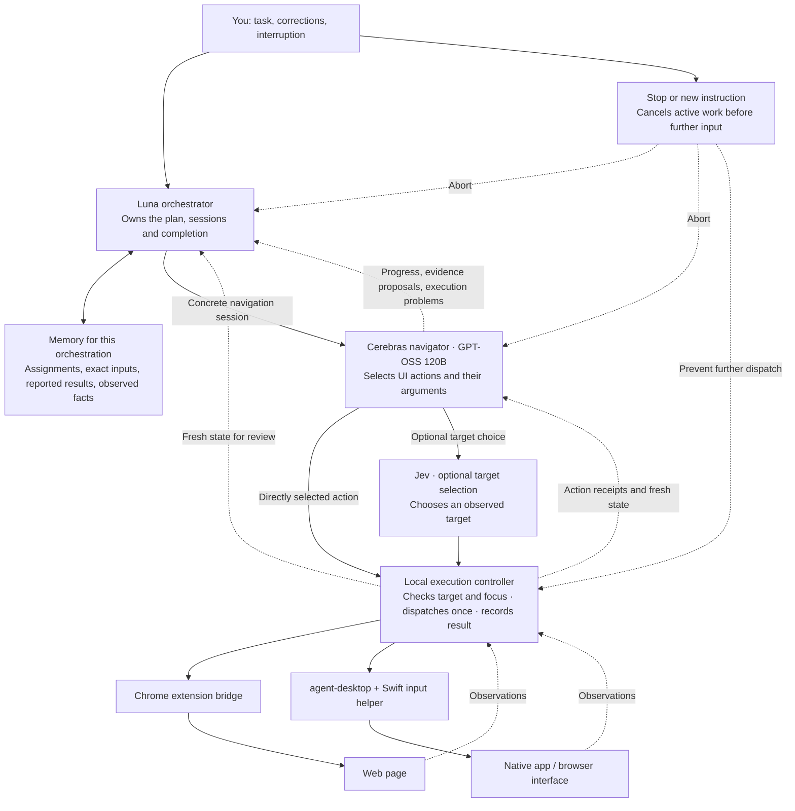

# System authority

This describes the default orchestrated v2 path. The older v1 mode remains a separate comparison implementation.

Luna decides what remains, supplies concrete choices, assigns the next session, and accepts milestone/task completion. A navigator completion proposal is a report, not a state transition. Premature proposals leave the milestone open. Parent review uses fresh observations and result evidence, retaining all previous action receipts.

Cerebras and optional Jev handle local action/target selection. They do not choose subsequent milestones or declare the task complete. A navigation session can yield progress or a technical obstacle; this hands control back to Luna without ending the task.

The execution controller checks live references, capabilities, focus, delivery and duplicate/uncertain attempts. A failed execution check returns evidence to the planner/orchestrator; it does not replace Luna's task judgment. Platform permissions and action confirmations remain separate from model-generated clarification questions, which are disabled in orchestrated mode.

Luna's memory belongs to one orchestration: a new user instruction starts empty, while controller sessions within that run share semantic history. There is no disk persistence or cross-task history. Assignments and controller results append to a stable prefix; the goal, current screen and action ledger appear separately at the end. Screens and individual clicks are not accumulated in memory. Older records are checkpointed at the working-context boundary. This enables provider prefix-cache reuse; cache hits are measured rather than assumed.

Luna chooses exact inputs and the session return condition. The navigator returns a structured report with observed evidence and remaining work. The controller binds its requirement ID to the assigned milestone. Luna can authorize repeated reversible controls for a sequence; uncertain delivery still requires inspection before another mutation. New milestones can be appended as work is discovered without erasing established obligations.

Delivered but unverifiable work has a separate completion path: Luna must identify the missing outcome signal, and no unfinished requirement may remain. Partial entry or an unfinished iterative task cannot use that path. Transient parent API errors preserve task state and retry without desktop input; quota/access errors remain terminal service failures. Diagnostics distinguish incomplete output, timeouts, invalid response contracts and HTTP failures.

There is no orchestrated task step, time, session-count, session-length or semantic-correction retry limit. Luna assigns each navigation session an objective and an observable return condition. The navigator returns on that condition, a needed planning decision, an execution problem or a detected loop; it has no numeric step allowance. Repeating a rejected proposal on unchanged content returns the issue to Luna for recovery rather than ending the task. Stop or a replacement prompt cancels further work; input already delivered cannot be undone by cancellation. Verified completion, a concrete blocker reported by Luna or an unrecoverable service failure can also end a run. API payload/context bounds and per-request transport timeouts remain separate from task budgets.
